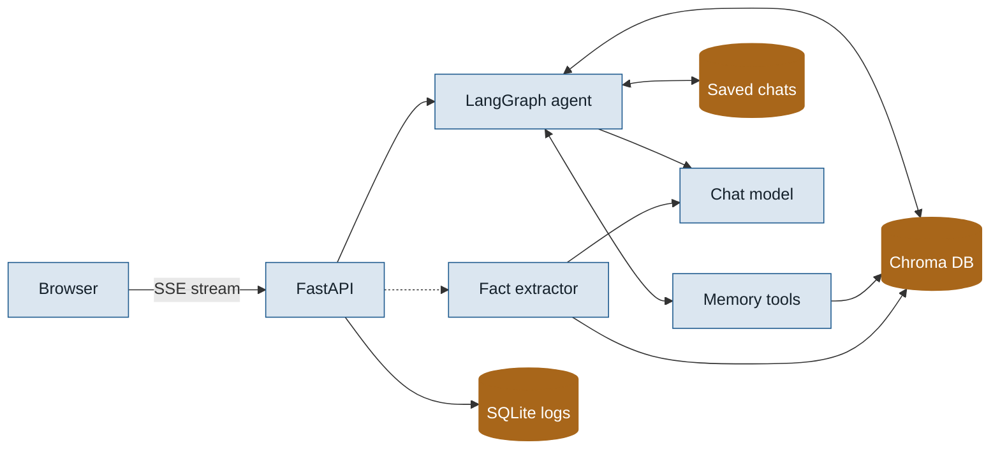
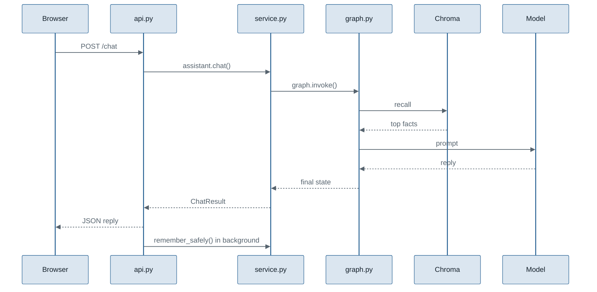
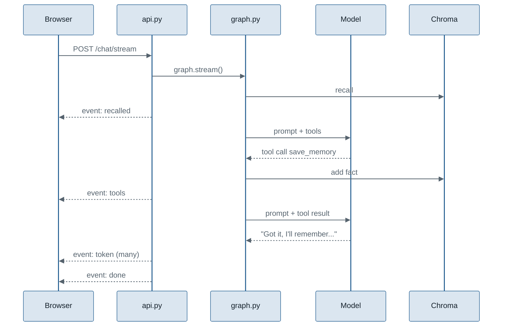
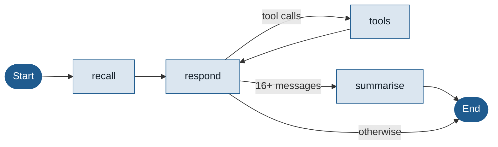

# How it works: a guide for building this project yourself

This guide is for anyone who wants to understand this project well enough to build something like it from scratch. It explains the ideas first, then each technology and why it was chosen, then walks through the code file by file in the order a message travels through it. At the end there's a suggested build order and some exercises.

You should be comfortable with basic Python (functions, classes, dictionaries) and have used a terminal. No prior experience with LLMs, vector databases or LangGraph is assumed.

**Contents**

1. [The problem in one picture](#1-the-problem-in-one-picture)
2. [Core ideas you need](#2-core-ideas-you-need) (embeddings, vector search, agents, tool calling, streaming)
3. [The technologies and why each one is used](#3-the-technologies-and-why-each-one-is-used)
4. [The big picture](#4-the-big-picture)
5. [Following one message through the code](#5-following-one-message-through-the-code)
6. [File-by-file walkthrough](#6-file-by-file-walkthrough)
7. [Design decisions and the alternatives](#7-design-decisions-and-the-alternatives)
8. [Testing without an API key](#8-testing-without-an-api-key)
9. [Measuring whether memory helps](#9-measuring-whether-memory-helps)
10. [Build it yourself: a suggested order](#10-build-it-yourself-a-suggested-order)
11. [Exercises](#11-exercises)
12. [Glossary](#12-glossary)

---

## 1. The problem in one picture

A large language model (LLM) like Gemini or GPT has **no memory of its own**. Every request is independent. If you want it to "remember" something, you have to send that information again in the prompt.

So every chatbot has to decide *what* to send. There are two naive answers, and both are bad:

| Approach | What happens |
|---|---|
| Send nothing from before | The bot forgets your name the moment you start a new chat |
| Send the entire history every time | Slow, expensive, eventually too long for the model, and the important facts get buried in small talk |

This project does something in between:

- It keeps **long-term memory**: short facts about you ("The user is doing an MSc in Data Science at Queen Mary"), stored in a database and searched by meaning.
- It keeps **short-term memory**: the current conversation, with older parts shrunk into a summary.
- On each message, it sends the model only the **relevant** facts, the summary and the last few messages.

---

## 2. Core ideas you need

### 2.1 Prompts and messages

When you call a chat model you send a list of messages, each with a role:

- **system**: instructions for how the model should behave ("You are a friendly assistant...")
- **human** (or user): what the person typed
- **ai** (or assistant): what the model said before

The model reads the whole list and writes the next AI message. Everything this project does is about building the right list.

### 2.2 Embeddings: turning text into numbers that capture meaning

An **embedding model** turns a piece of text into a list of numbers (a vector). This project uses `all-MiniLM-L6-v2`, which produces 384 numbers per sentence.

The useful property: **sentences with similar meaning get similar vectors**, even when they share no words.

- "What am I studying?" and "The user is doing an MSc in Data Science" have different words but are about the same thing, so their vectors point in a similar direction.
- "What am I studying?" and "The user has a cat called Biscuit" point in different directions.

### 2.3 Cosine similarity: how close two meanings are

To compare two vectors we use **cosine similarity**: the cosine of the angle between them.

```
cosine(a, b) = (a · b) / (|a| × |b|)
```

- 1.0 means the same direction (same meaning)
- 0 means unrelated
- negative means opposite

For short sentences, real scores are often lower than you'd expect. In this app, "What am I studying?" against "The user is pursuing an MSc in Data Science at Queen Mary" scored about **0.29**, which was still the best match, so it was recalled. That's why the code ranks matches rather than demanding a high score.

### 2.4 Vector databases

A **vector database** stores text together with its embedding, and answers the question "which stored items are closest to this vector?" quickly. This project uses **Chroma DB**. Each stored memory also has **metadata** (user id, category, importance, timestamps), and searches can filter on metadata, so one user never sees another's memories.

### 2.5 Retrieval before generation (the RAG pattern)

"Retrieval-augmented generation" means: before asking the model, **retrieve** relevant information and put it in the prompt. Usually RAG retrieves from documents; here it retrieves from facts about the user. The steps are the same:

1. embed the question
2. search the vector database
3. add the best results to the prompt
4. generate the answer

### 2.6 Agents and graphs

An **agent** here just means "a program that runs a few steps around an LLM call". LangGraph lets you write those steps as a **graph**: nodes are functions, edges say what runs next, and a shared **state** dictionary flows through them. A **checkpointer** saves the state after each run, keyed by a **thread id**, which is how a conversation continues where it left off. This project's checkpointer writes to a SQLite file, so chats survive a restart.

### 2.7 Tool calling: letting the model act

Normally a model can only write text. With **tool calling**, you describe some functions to it (name, purpose, arguments). Instead of answering, the model can reply with a request like:

```json
{"name": "save_memory", "args": {"text": "The user's sister is called Asha.", "category": "profile"}}
```

Your code runs the function, sends the result back as a **tool message**, and calls the model again. It can then answer, or ask for another tool. This loop is how the assistant saves, searches and forgets memories when you ask it to. The model never touches the database itself; your code decides what each tool is allowed to do.

### 2.8 Streaming: showing the answer as it's written

Models generate text a few tokens at a time. **Streaming** sends each piece to the browser as soon as it exists, instead of waiting for the whole reply. This project uses **Server-Sent Events (SSE)**: one HTTP response that stays open and carries a series of small messages like:

```
event: token
data: {"type": "token", "text": "You're "}
```

The total time is the same, but you start reading much sooner. The useful number becomes **time to first token**.

---

## 3. The technologies and why each one is used

| Technology | What it is | Why this project uses it | What you could use instead |
|---|---|---|---|
| **Python 3.12** | The language | The LLM and data ecosystem lives here. 3.10–3.13 are supported; newer versions may lack builds of numpy/Chroma. | — |
| **LangChain (core)** | Standard message types and model interfaces | One `invoke()` interface for Gemini, OpenAI and Ollama, so switching models is a config change | Call each provider's SDK directly |
| **LangGraph** | A library for building LLM workflows as graphs with state | Clear steps (recall → respond ⇄ tools → summarise), conditional branches, a tool-calling loop, token streaming, and a checkpointer that stores each conversation | A hand-written loop plus your own conversation store |
| **langgraph-checkpoint-sqlite** | LangGraph's SQLite checkpointer | Saves every chat's state to a file, so chats survive restarts with no database server | Postgres checkpointer for many users |
| **Chroma DB** | A local, persistent vector database | Runs on a laptop with no server, saves to disk, supports cosine search and metadata filters | FAISS (no metadata filters built in), pgvector (needs Postgres), Qdrant, Pinecone (hosted) |
| **sentence-transformers / all-MiniLM-L6-v2** | A small local embedding model | Free, about 90 MB, fast on a CPU, good for short sentences, no API calls (so no rate limits for recall) | OpenAI or Gemini embedding APIs (smaller install, but network calls and quotas) |
| **Gemini / OpenAI / Ollama** | The chat models | Gemini has a free tier; OpenAI is cheap and reliable; Ollama runs fully locally | Any LangChain-supported model |
| **FastAPI** | A Python web framework | Typed request models, automatic API docs at `/docs`, **background tasks** (so saving memories doesn't slow replies) and `StreamingResponse` for Server-Sent Events | Flask (no built-in typing/validation), Django (heavier) |
| **Uvicorn** | The server that runs FastAPI | Standard choice, auto-reload during development | Hypercorn, Gunicorn with workers |
| **SQLite** | A file-based SQL database | Interaction logs and the chat list, with zero setup | Postgres for multi-user deployments |
| **NumPy** | Numerical arrays | PCA (via SVD) to draw the 2-D memory map | scikit-learn's PCA |
| **Plain HTML/CSS/JS** | The web UI | One file, no build step, easy to read | React, Streamlit, Gradio |
| **pytest + GitHub Actions** | Testing and CI | Tests run offline with fakes, so CI needs no API key | unittest |

---

## 4. The big picture



Two flows happen for every message:

1. **The reply flow (solid lines)**: the user watches this happen. Recall facts, build the prompt, call the model (which may use memory tools), and stream the answer back.
2. **The memory flow (dashed line)**: runs in the background after the reply is sent. Ask the model which facts in the message are worth keeping, then store them.

So memories get written in two ways: automatically in the background, and on purpose when the model uses `save_memory` because you asked it to.

---

## 5. Following one message through the code

Say user `demo` types **"What am I studying?"** in thread `test2`.



Step by step:

1. **Browser** (`app/static/index.html`) sends `POST /chat` with `{"user_id": "demo", "thread_id": "test2", "message": "What am I studying?", "use_memory": true}`.
2. **`app/api.py` → `chat()`** validates the body with a Pydantic model, then calls `assistant.chat(...)`.
3. **`app/service.py` → `Assistant.chat()`** builds a LangGraph config with `thread_id = "demo:test2"` and `user_id = "demo"`, starts a timer and calls `graph.invoke(...)` with the new human message.
4. **The checkpointer** loads any earlier messages and summary for `demo:test2`. LangGraph appends the new message to the state.
5. **`recall` node** takes the latest human message and calls `memory.recall("demo", "What am I studying?")`.
6. **`app/memory/long_term.py` → `LongTermMemory.recall()`** embeds the question, asks Chroma for the 15 nearest memories belonging to `demo`, re-ranks them with the scoring formula, drops weak ones and returns the top 5.
7. **`respond` node** builds the prompt: system rules, a short guide to the memory tools, "What you remember about this user: - The user is pursuing an MSc...", the summary if there is one, then the conversation messages. It calls the chat model.
8. **`app/retry.py`** wraps that call: if the provider says it's busy, it waits and tries again.
9. **`after_respond`** checks whether the model asked for tools (section 5.1 covers that case), then the thread length. If it has reached 16 messages, the `summarise` node folds the oldest ones into the summary and removes them.
10. **Back in `Assistant.chat()`**, the reply text is pulled out (`message_text`), latency is measured, and the turn is written to the SQLite log.
11. **`api.py`** returns the reply, the recalled memories and the latency as JSON, and schedules `remember_safely()` as a background task.
12. **Background:** `Assistant.remember()` sends the message to the model with the extraction prompt, parses the JSON list of facts, and calls `memory.add()` for each. Here "What am I studying?" contains no facts, so nothing is stored.
13. **Browser** shows the reply, the response time and how many memories were used; the Recalled panel lists them with their scores.

### 5.1 The streaming version, with a tool call

The web page actually uses `POST /chat/stream`. Say the user types **"Remember that my sister is called Asha."**



1. **`Assistant.chat_stream()`** calls `graph.stream(..., stream_mode=["messages", "updates"])`. LangGraph then yields two kinds of item: **updates** when a node finishes, and **message chunks** as the model writes.
2. When the `recall` node finishes, it yields a `recalled` event, so the panel fills in before the answer starts.
3. The `respond` node calls a version of the model with tools attached (`bind_tools`). The model asks for `save_memory`.
4. The `tools` node runs `run_tool()` for the current user, adds the fact to Chroma, and returns a `ToolMessage` with the result plus a short label for the UI ("Saved: The user's sister is called Asha."). A `tools` event goes to the browser.
5. The graph goes back to `respond`. Now the model answers in text, and each chunk becomes a `token` event. Chunks from the summary step are ignored, so only the answer streams.
6. At the end, `chat_stream()` reads the final state, logs the turn (including the time to the first token and the tools used) and sends `done`.
7. **`api.py`** turns each event into SSE text (`event: …` / `data: …`) inside a `StreamingResponse`. After `done`, it starts the background fact extraction in a separate thread.
8. **The browser** reads the stream with `fetch()` and a reader, adds tokens to the bubble as they arrive, and shows the tool chips and timings when `done` arrives.

---

## 6. File-by-file walkthrough

```
app/
  config.py        settings
  llm.py           model + embedding factories, reply text helper
  retry.py         retries for busy models
  memory/
    long_term.py   Chroma store, ranking, duplicates, memory map
    extractor.py   deciding what to remember
    tools.py       memory tools the model can call
    short_term.py  summary helpers
  graph.py         the LangGraph agent
  service.py       Assistant class tying it together
  logs.py          SQLite interaction log and chat list
  api.py           FastAPI routes
  static/index.html  web UI
eval/              evaluation
tests/             tests
```

### 6.1 `app/config.py`: settings

All tunable values live in one frozen dataclass, `Settings`, read from environment variables. A small loader reads `.env` first (so `python-dotenv` isn't required) and ignores comments at the end of lines.

Key settings and what they control:

| Setting | Default | Controls |
|---|---|---|
| `LLM_PROVIDER`, `LLM_MODEL` | `openai`, `gpt-4o-mini` | Which chat model |
| `LLM_MAX_RETRIES` | 4 | Retries when the model is busy |
| `LLM_MAX_TOKENS`, `LLM_TIMEOUT`, `LLM_THINKING_LEVEL` | 1024, 60, `low` | Speed |
| `EMBEDDING_PROVIDER`, `EMBEDDING_MODEL` | `huggingface`, MiniLM | How text becomes vectors |
| `VECTOR_BACKEND` | `chroma` | `chroma` on disk, or `memory` for tests |
| `RECALL_TOP_K`, `RECALL_MIN_SCORE` | 5, 0.25 | How many facts go into the prompt, and the cut-off |
| `DUPLICATE_THRESHOLD` | 0.92 | When a new fact replaces an old one |
| `KEEP_RECENT_MESSAGES` | 8 | Short-term memory window |
| `AGENT_TOOLS`, `MAX_TOOL_ROUNDS` | `true`, 3 | Whether the model can use memory tools, and how many rounds per message |
| `CHECKPOINT_PATH` | `data/threads.sqlite` | Where chats are saved (`:memory:` to keep them in memory only) |

**Why a dataclass?** Typed, one place to look, and easy to override in tests (`Settings(keep_recent_messages=4)`).

### 6.2 `app/llm.py`: models and embeddings

Three things live here:

- **`get_chat_model(settings)`** builds the chosen provider's LangChain chat model (imported lazily, so you only install the one you use) and wraps it in `RetryingChatModel`. For Gemini it also sets the thinking level and output cap.
- **`get_embeddings(settings)`** returns an object with `embed_query(text)` and `embed_documents(texts)`. Options: Hugging Face (local), OpenAI, Gemini, or `HashEmbeddings`.
- **`HashEmbeddings`** is a tiny offline embedder for tests: it hashes each word into one of 512 slots. It only captures word overlap, not meaning, but it's deterministic and needs no download.
- **`message_text(message)`** returns the plain text of a reply. Some providers (Gemini 3) return a list of content blocks, `[{"type": "text", "text": "..."}, ...]`, rather than a string; this keeps only the text parts.

### 6.3 `app/retry.py`: surviving busy models

Hosted models on free tiers often reply "503 high demand" or "429 quota", or drop the connection. `RetryingChatModel.invoke()`:

1. calls the real model
2. on error, checks `is_transient(error)` by looking for markers like `503`, `429`, `quota`, `timeout`, `disconnected` in the error text
3. if transient and retries remain, sleeps 1.5 s, 3 s, 6 s, 12 s (times a random 0.8–1.2 "jitter", so many clients don't retry in sync) and tries again
4. if not transient (bad key, wrong model name), raises immediately, since retrying won't help
5. after the last retry, raises `ModelBusyError`, which the API turns into a friendly 503

It also has a `bind_tools()` method that attaches tools to the real model and wraps the result again, so tool-calling requests get the same retries.

### 6.4 `app/memory/long_term.py`: the heart of the project

**Data shapes**

- `MemoryRecord`: one fact: `id`, `user_id`, `text`, `category` (profile / preference / goal / project / other), `importance` (0–1), `created_at`, `updated_at`, `times_recalled`.
- `RecalledMemory`: a record plus its `similarity` and final `score`.

**Backends** share one small interface (`upsert`, `get`, `query`, `list`, `delete`):

- `ChromaBackend`: one persistent collection with cosine distance. Every query filters `where={"user_id": ...}`. Chroma returns cosine *distance*, so similarity is `1 - distance`.
- `InMemoryBackend`: plain Python with the same interface, for tests.

This is the **strategy pattern**: `LongTermMemory` doesn't care which backend it has.

**Adding a fact: `LongTermMemory.add()`**

```
embedding = embed(text)
closest = backend.query(user_id, embedding, k=1)
if closest similarity >= 0.92:
    update that record (new wording, higher importance, new timestamp)
else:
    create a new record
backend.upsert(record, embedding)
```

The update branch is how corrections work: "My coffee shop is called Ember & Oak now" is very close to "My coffee shop is called Ember", so it replaces it instead of keeping both.

**Recalling: `LongTermMemory.recall()`**

```
hits = backend.query(user_id, embed(query), k = top_k * 3)    # over-fetch
for each hit:
    score = 0.75*similarity + 0.15*importance + 0.10*recency
keep score >= 0.25, sort by score, return top 5
```

with `recency = 0.5 ** (age_days / 30)`, so a memory loses half its recency weight every 30 days.

Why over-fetch? Chroma ranks only by similarity. A slightly less similar but much more important fact might be 7th by similarity and 2nd by score, so we fetch 15 and re-rank.

Why these weights? Relevance should dominate (0.75). Importance (0.15) lets "my name is Priya" beat a passing remark. Recency (0.10) gently favours newer facts without forgetting old ones. They're tunable; the exercises suggest experimenting.

**Editing: `LongTermMemory.update()`** fetches a memory by id (only if it belongs to that user), changes its text, category or importance, and re-embeds it if the text changed, so search still finds it by its new meaning.

**Memory map: `projection()`** stacks the user's embeddings into a matrix, centres it, and uses SVD to project onto the top 2 principal components. Points close together on the map are similar in meaning.

### 6.5 `app/memory/extractor.py`: deciding what to remember

`extract_facts(model, message)` sends the message with a prompt that asks for durable facts only, one third-person sentence each, as JSON:

```json
[{"text": "The user's name is Priya.", "category": "profile", "importance": 0.9}]
```

`parse_extracted_facts(raw)` is deliberately forgiving, because models don't always follow formats exactly. It strips code fences, takes the text between the first `[` and last `]`, accepts plain strings, clamps importance to 0–1, maps unknown categories to `other`, and returns `[]` instead of crashing.

**Why use the LLM for extraction instead of rules?** Rules can't cope with the variety of ways people say things. The cost is one extra model call per message, which is why it runs in the background.

### 6.6 `app/memory/tools.py`: memory tools

Three tools are defined with LangChain's `@tool` decorator. The decorator turns each function's name, docstring and arguments into the description the model sees, so the docstrings are written for the model:

| Tool | Arguments | What `run_tool()` does |
|---|---|---|
| `search_memory` | `query` | Recalls up to 5 memories and returns them with their ids |
| `save_memory` | `text`, `category`, `importance` | Cleans the arguments and calls `memory.add()` (so duplicates still merge) |
| `forget_memory` | `memory_id` | Checks the memory belongs to this user, then deletes it |

**Why are the decorated functions empty?** They only describe the tools. The real work happens in `run_tool(memory, user_id, name, args)`, which receives the user id from the graph's config, not from the model. That means the model can't read or delete another user's memories, whatever it asks for.

`run_tool()` returns two things: text for the model ("Saved [id] …") and a small event for the UI (`{"name": "save_memory", "label": "Saved: …"}`), which becomes a chip under the reply. Errors are returned as text instead of raised, so a failed tool doesn't break the conversation.

`TOOL_GUIDE` is added to the system prompt to tell the model when to use each tool.

### 6.7 `app/memory/short_term.py`: summaries

- `split_for_summary(messages, keep_recent, is_start)` returns `(older, recent)`. The `is_start` check moves the cut to a user message, so a tool call is never separated from its tool result. Chat APIs reject a conversation that starts with a tool result.
- `build_summary_prompt(summary, older)` asks the model to fold the older messages into the existing summary, keeping names, decisions and open questions.

### 6.8 `app/graph.py`: the LangGraph agent

**State** is a typed dictionary:

```python
class AgentState(TypedDict, total=False):
    messages: Annotated[list[AnyMessage], add_messages]
    summary: str
    recalled: list[dict]
    tool_events: list[dict]   # labels for the UI
    tool_rounds: int          # how many tool rounds this turn
```

`Annotated[..., add_messages]` is a **reducer**: when a node returns `{"messages": [new]}`, LangGraph *appends* rather than replaces. Returning `RemoveMessage(id=...)` deletes a message, which is how summarising trims the thread.

**Nodes** are plain functions that take the state (and config) and return a partial update:

- `recall`: reads `user_id` and `use_memory` from the config, searches long-term memory, returns `{"recalled": [...]}`. It also resets `tool_events` and `tool_rounds` for the new turn.
- `respond`: builds the system message from the rules, the tool guide, recalled facts and summary; calls the model with tools attached; returns `{"messages": [reply]}`. Once `MAX_TOOL_ROUNDS` is reached it calls the model **without** tools, so every turn ends with text.
- `tools`: runs each requested tool for this user and returns the `ToolMessage` results.
- `summarise`: folds older messages into `summary` and removes them.

**Edges** wire them up:

```python
graph.add_edge(START, "recall")
graph.add_edge("recall", "respond")
graph.add_conditional_edges("respond", after_respond, {"tools": "tools", "summarise": "summarise", END: END})
graph.add_edge("tools", "respond")
graph.add_edge("summarise", END)
```



`after_respond` sends the graph to `tools` if the model asked for any, back to `respond` afterwards, and otherwise to `summarise` once the thread holds `2 × KEEP_RECENT_MESSAGES` messages. Batching like this means the extra summary call happens about once every 4 turns rather than every turn.

**Checkpointer:** `build_checkpointer()` returns LangGraph's `SqliteSaver` writing to `data/threads.sqlite`, so each chat's messages and summary survive restarts. If the package isn't installed, it falls back to `InMemorySaver` and logs a warning.

### 6.9 `app/service.py`: the `Assistant` class

The one object the API talks to. It builds the model, memory, log and graph, and offers:

- `chat(user_id, thread_id, message, use_memory)`: runs the graph, times it, logs it and returns a `ChatResult` (reply, recalled memories, tools used, latency).
- `chat_stream(...)`: the same, but yields `recalled`, `token`, `tools` and `done` events as they happen (section 5.1).
- `threads()`, `thread_history()`, `delete_thread()`: list, reopen and delete saved chats. Deleting removes the log rows and the checkpoint; long-term memories stay.
- `remember(user_id, message, log_id)`: extracts and stores facts.
- `remember_safely(...)`: the background version, which logs errors instead of raising them.
- `summary(user_id, thread_id)`: reads a thread's summary from the checkpointer.

Keeping this separate from `api.py` means the evaluation script and tests can use the assistant without a web server. This is **separation of concerns**.

### 6.10 `app/logs.py`: interaction log

A small SQLite table with one row per turn: time, user, thread, message, reply, recalled memories, stored memories, tools used, total latency and time to first token. A lock makes it safe when FastAPI runs handlers on several threads.

It also powers the chat sidebar. `threads()` groups rows by thread and titles each chat by its first message; `thread_turns()` returns a chat's full history. The checkpointer only keeps the summary plus recent messages, so the log is what lets you scroll back through a whole chat.

When it opens an older database that's missing the newer columns, it adds them with `ALTER TABLE`. That's a tiny **migration**, so existing logs keep working after an upgrade.

### 6.11 `app/api.py`: the web API

- `lifespan` warms up the embedding model when the server starts, so the first message isn't slow.
- `get_assistant()` is cached (`lru_cache`), so there's one `Assistant` per process.
- Exception handlers turn `ModelBusyError` into a 503 with a friendly message, and anything else into a 500 with a short description.
- `POST /chat` replies, then adds `remember_safely` as a **background task**: FastAPI sends the response first and runs the task afterwards.
- `POST /chat/stream` wraps `chat_stream()` in a `StreamingResponse` with media type `text/event-stream`. Errors are sent as an `error` event, because the response has already started and can't change its status code.
- Chat routes list, reopen and delete chats; memory routes list, add, **edit** (`PATCH`) and delete memories; others return the memory map, a thread summary and logs.

### 6.12 `app/static/index.html`: the UI

One file with no framework, in three columns:

- **Chats sidebar:** loads `/threads`, opens a chat by loading its messages, deletes chats, and starts new ones. The current chat id is remembered in the browser's `localStorage`, so a refresh reopens it. On narrow screens it becomes a slide-out drawer.
- **Conversation:** `send()` posts to `/chat/stream` and reads the response with `res.body.getReader()`. A small `sse()` generator splits the bytes into events. Tokens are appended to the bubble and rendered with a tiny, safe markdown function (text is escaped first, then bold, italics, lists and code are added). When `done` arrives, chips show time to first word, total time, memories used and each tool used.
- **Side panel:** Recalled, Memories (search, category filters, add, inline edit with a category menu and importance slider, delete, and export to a JSON file made in the browser), Map (drawn on a `<canvas>`) and Logs (medians rather than averages, so one slow reply doesn't distort them).

Colours and fonts come from CSS variables with a dark-mode variant, and the layout collapses to one column on a phone.

---

## 7. Design decisions and the alternatives

| Decision | Chosen | Why | Trade-off |
|---|---|---|---|
| When to recall | Always before replying, plus a `search_memory` tool | The fast path covers most questions; the tool covers the rest | A search runs even when nothing is relevant |
| Who changes memory | Background extraction **and** model tools | Automatic saving catches facts said in passing; tools handle explicit "remember / forget" | Each tool call is an extra model request |
| Tool safety | User id comes from the server, not the model | The model can't touch another user's memories | — |
| Streaming | Server-Sent Events over a POST | One-way, simple, works through `fetch` | Not as flexible as WebSockets for two-way messages |
| Saved chats | SQLite checkpointer + log table | No server needed; full history even after summarising | One file; for many users you'd use Postgres |
| What to store | Extracted facts, not raw messages | Facts are short, clean and easy to de-duplicate | Needs a model call per message |
| When to store | Background task | User doesn't wait | A fact said in one message isn't available until a moment later |
| Ranking | Weighted similarity + importance + recency | Relevance first, with sensible tie-breakers | Weights are hand-picked |
| Duplicates | Replace when cosine ≥ 0.92 | Handles corrections and repeats | Two genuinely different but similar facts could merge |
| Short-term memory | Batched rolling summary | Prompt stays small; fewer extra calls | Fine details in old turns can be lost |
| Embeddings | Local MiniLM | Free, fast, no rate limits | 1–2 GB install because of PyTorch |
| One collection, filtered by user | Yes | Simple; Chroma filters are fast | For millions of users you'd shard |

---

## 8. Testing without an API key

Tests swap the expensive parts for fakes:

- `InMemoryBackend` instead of Chroma
- `HashEmbeddings` instead of a real embedding model
- a `ScriptedModel` that returns canned replies depending on the prompt (fact JSON for extraction prompts, a fixed summary for summary prompts, "Noted!" otherwise). With tools attached it also returns scripted **tool calls**: `save_memory` for "Remember that my sister…", and `search_memory` then `forget_memory` for "Forget my sister…"
- LangChain's `GenericFakeChatModel` for streaming, which yields a reply in chunks like a real model
- `:memory:` for the SQLite checkpointer and log

That makes it possible to test the whole agent end to end in under a second, with no network: a fact told in one chat is recalled in another; tools save, search and forget; streaming sends `recalled`, tokens and `done` in order; saved chats are listed and deleted; and summarising never leaves a tool result without its call. GitHub Actions runs the tests on every push.

Run them with:

```bash
python -m pytest
```

---

## 9. Measuring whether memory helps

`eval/run_eval.py`:

1. For each persona in `eval/scenarios.json` (e.g. Priya: nurse, vegetarian, training for a half marathon), it tells the assistant the facts in a "teach" thread and saves memories.
2. For each probe question (e.g. "Suggest a quick dinner I could make tonight"), it asks in a **brand-new thread**, so only long-term memory can help, once with memory on and once with it off.
3. A probe passes if the reply contains an expected keyword (whole-word match; `allerg*` style prefixes allowed).
4. It reports continuity with vs without memory, and latency (mean, median, p95) for the full turn and the recall step on its own.

```bash
python -m eval.run_eval --runs 1 --delay 5
```

The baseline matters: without it, "85% continuity" could mean the model was guessing well, not remembering.

---

## 10. Build it yourself: a suggested order

Build in small steps, getting each working before the next:

1. **Call a model.** A script that sends one message to Gemini or OpenAI through LangChain and prints the reply.
2. **Embeddings and similarity.** Embed a few sentences with sentence-transformers and print the cosine similarity between pairs. Get a feel for the numbers.
3. **Store and search.** Put five facts in a Chroma collection with a `user_id` in metadata; query with a question; print the nearest. Then try two users.
4. **Ranking.** Add importance and timestamps; implement the scoring formula; check that ordering changes as expected.
5. **Prompt with memory.** Put the top facts into a system message and ask the model a question that needs them.
6. **Extraction.** Write the extraction prompt and a forgiving JSON parser; test it on ten varied messages.
7. **De-duplication.** Before storing, check the nearest existing fact and update it if it's very close.
8. **LangGraph.** Move recall and respond into nodes, add a checkpointer, and continue a conversation by thread id.
9. **Summarising.** Add the conditional summary node.
10. **API.** Wrap it in FastAPI with `POST /chat` and background memory saving.
11. **UI.** A simple HTML page that calls the API; then add the panels.
12. **Retries.** Wrap the model with retry logic once you've seen your first 503.
13. **Memory tools.** Define `save_memory`, `search_memory` and `forget_memory`, bind them to the model, and add a `tools` node that loops back to `respond`.
14. **Streaming.** Switch to `graph.stream()`, send events over SSE, and read them in the browser.
15. **Saved chats.** Swap in the SQLite checkpointer and build the chat list from the log.
16. **Memory editing.** Add `update()` and a `PATCH` route, then the edit form in the UI.
17. **Tests.** Fakes for the model, embeddings and store; then end-to-end tests, including scripted tool calls.
18. **Evaluation.** Personas, probes, a baseline, and a results file.

---

## 11. Exercises

1. **Tune the ranking.** Change the weights in `long_term.py` and rerun the evaluation. Does continuity go up or down?
2. **Tools only.** Turn off the automatic recall step and rely only on `search_memory`. How does continuity change, and how many extra requests does it cost?
3. **An `update_memory` tool.** Let the model correct a fact in place instead of forgetting and saving.
4. **Stop button.** Add a way to cancel a streaming reply from the browser.
5. **Better scoring.** Use a second model call as a judge in the evaluation, alongside keyword matching.
6. **Forgetting.** Add decay: lower the importance of memories that are never recalled.
7. **Merge related facts.** Periodically combine facts like "likes tea" and "drinks green tea daily" into one.

---

## 12. Glossary

| Term | Meaning |
|---|---|
| **LLM** | Large language model; generates text from a prompt |
| **Prompt** | The list of messages sent to the model |
| **Token** | A chunk of text (roughly ¾ of a word) that models read and write; limits and costs are counted in tokens |
| **Embedding** | A list of numbers representing the meaning of a text |
| **Cosine similarity** | How closely two embeddings point the same way (1 = same, 0 = unrelated) |
| **Vector database** | A database that finds stored items nearest to a given embedding |
| **Metadata filter** | Restricting a vector search to items with certain metadata, e.g. one user |
| **RAG** | Retrieval-augmented generation: fetch relevant information, then generate |
| **Node / edge / state** | LangGraph's building blocks: a step, what runs next, and the shared data |
| **Reducer** | A rule for combining a node's output with existing state (e.g. append messages) |
| **Checkpointer** | Saves graph state per thread so a conversation can continue |
| **Thread** | One conversation, identified by a thread id |
| **Background task** | Work FastAPI runs after sending the response |
| **Tool calling** | The model asks your code to run a named function with arguments, then uses the result |
| **Tool message** | The result of a tool, sent back to the model as its own message |
| **Streaming** | Sending the reply in pieces as it's generated |
| **SSE (Server-Sent Events)** | A simple format for streaming events from server to browser over one HTTP response |
| **Time to first token** | How long until the first piece of the reply appears |
| **Migration** | Changing a database's structure while keeping its data |
| **Exponential backoff** | Waiting longer after each failed retry (1.5 s, 3 s, 6 s...) |
| **PCA** | Principal component analysis; squeezes many dimensions into 2 for plotting |
| **p95 latency** | 95% of requests were faster than this |
