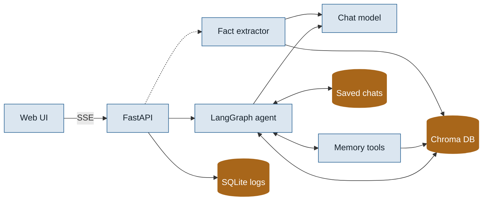
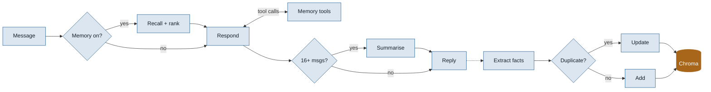
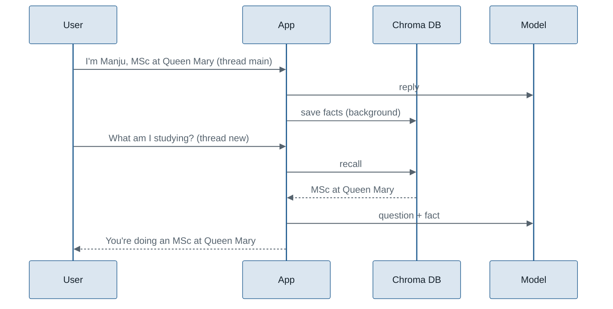
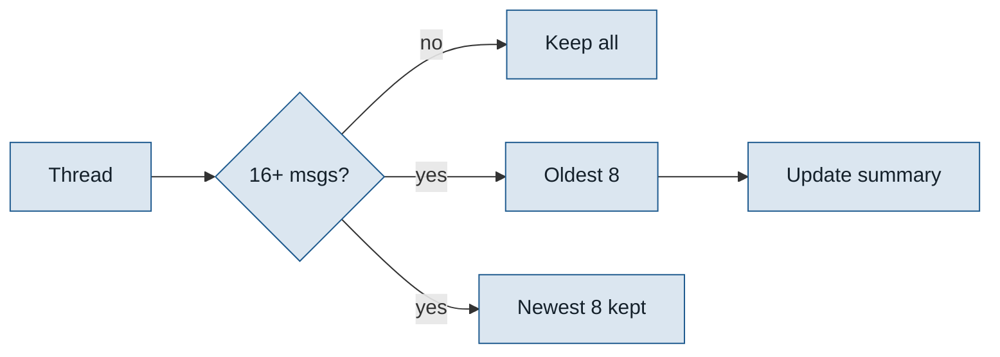
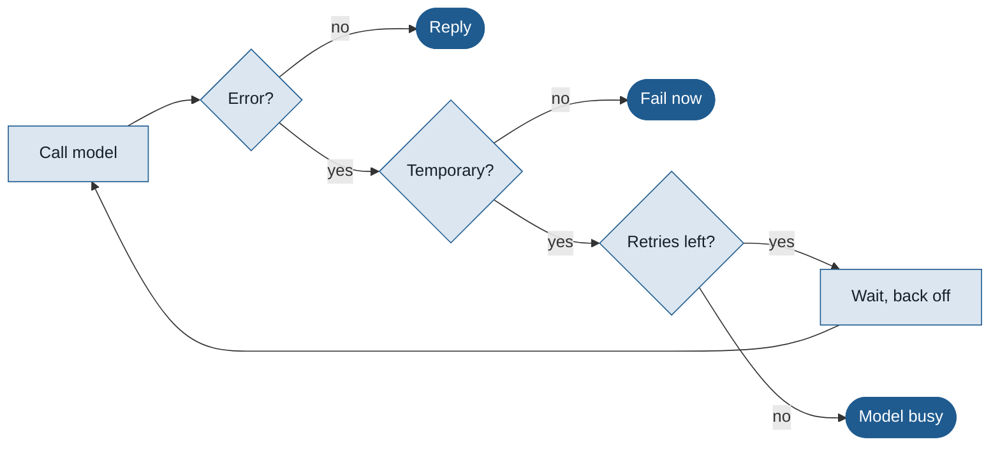
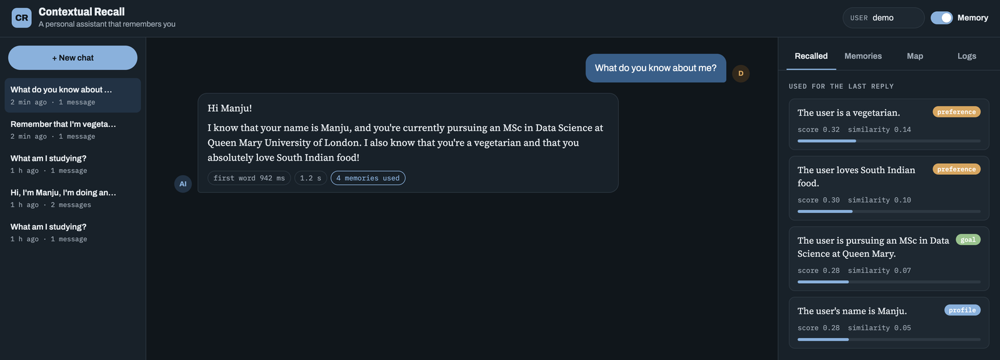
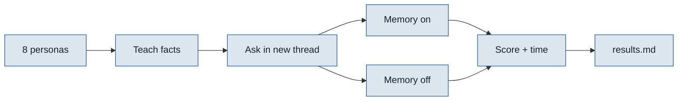

# Project report: Personalised AI Assistant with Contextual Recall

**Author:** Manju Swaroop V
**Stack:** Python, LangChain, LangGraph, Chroma DB, FastAPI, Hugging Face sentence-transformers, Gemini / OpenAI / Ollama
**Repository:** https://github.com/manjuv03/Personalized-AI-Assistant-with-Contextual-Recall

---

## 1. Summary

This is a chat assistant that remembers the people it talks to. If you tell it your name, your course or that you're vegetarian, it stores those facts and uses them in later conversations, even brand-new ones. It also keeps each conversation short by summarising older messages, so it stays fast as a chat grows.

It can also manage its own memory: ask it to remember or forget something and it uses memory tools to do so. Replies stream in word by word, and chats are saved so you can reopen them after a restart.

It has two kinds of memory:

- **Long-term memory:** durable facts about each user, stored as vectors in Chroma DB and found again by meaning, not exact words.
- **Short-term (contextual) memory:** the current conversation, kept by LangGraph, with older turns folded into a running summary.

A FastAPI backend serves the chat and a web page with a list of saved chats, the memories used for every reply, everything the assistant knows about you (searchable and editable), a 2-D map of those memories, and a log of every turn with its timings. An evaluation script measures how well it remembers across conversations, with memory switched on versus off.

---

## 2. Why I built it

Most chatbots have one of two problems:

1. **They forget.** Close the chat and everything you said is gone. Next time you have to explain yourself again.
2. **They remember everything, badly.** Some pass the whole history to the model on every turn. That gets slow and expensive, eventually hits the model's context limit, and buries the important facts among small talk.

Real assistants should behave more like a good colleague: remember what matters about you, bring it up when it's relevant, and not recite your life story every time you ask a question.

I wanted to understand how to build that properly: how to decide what's worth remembering, how to find the right memory at the right moment, how to keep conversations small, and how to *measure* whether memory actually helps rather than just claiming it does.

---

## 3. Goals

| Goal | How the project meets it |
|---|---|
| Remember facts across separate conversations | Long-term memory in Chroma DB, filtered by user |
| Only bring back what's relevant | Semantic search plus re-ranking by importance and recency |
| Handle corrections ("actually, it's called Ember & Oak now") | Near-duplicate facts replace the old one |
| Keep replies fast as chats grow | Rolling summary of older turns; memory saving runs in the background |
| Make memory visible and editable | UI panels for recalled memories, all memories (search, filter, add, edit, delete, export), memory map and logs |
| Let the user direct memory | Memory tools the model calls when asked to remember, look up or forget something |
| Feel responsive | Replies stream word by word; time to first word is shown |
| Keep conversations | Chats saved to SQLite, listed in a sidebar and reopened after restarts |
| Measure the effect of memory | Evaluation comparing continuity with memory on vs off, plus latency |
| Work with free or local models | Pluggable providers: Gemini (free key), OpenAI, Ollama (fully local) |

---

## 4. Technology choices

| Tool | Used for | Why |
|---|---|---|
| **LangGraph** | The agent's workflow (recall → respond ⇄ tools → summarise) | Explicit steps and state, a tool-calling loop, token streaming, a SQLite checkpointer for saved chats, and easy conditional branches |
| **LangChain** | Message types and model integrations | One interface for Gemini, OpenAI and Ollama |
| **Chroma DB** | Long-term memory store | Lightweight, runs locally, persistent, supports metadata filters (per user) and cosine search |
| **sentence-transformers (all-MiniLM-L6-v2)** | Turning text into vectors | Free, runs locally, fast on a laptop, good quality for short sentences |
| **FastAPI** | Web API and serving the UI | Fast, typed request models, Server-Sent Events for streaming, background tasks for memory saving, automatic docs at `/docs` |
| **SQLite** | Saved chats and the interaction log | Zero setup, enough for one machine |
| **NumPy** | PCA for the memory map | Simple 2-D projection of embeddings |
| **pytest + GitHub Actions** | Tests on every push | Tests run offline with fakes, so CI needs no API key |

---

## 5. System architecture



The dashed line runs in the background after the reply is sent. Memory tools run inside the agent's loop, using the current user's id from the server. Every model call goes through a retry wrapper, and Chroma DB uses local all-MiniLM-L6-v2 embeddings.

### Code layout

```
app/
  api.py              FastAPI routes, error handling, start-up warm-up
  service.py          Assistant: runs and streams the graph, saves memories, manages chats
  graph.py            LangGraph agent: recall -> respond <-> tools -> summarise
  memory/
    long_term.py      Chroma DB store, ranking, de-duplication, PCA map
    short_term.py     Rolling-summary helpers
    extractor.py      Fact extraction prompt and JSON parsing
    tools.py          Memory tools: search, save, forget
  retry.py            Retries for busy / rate-limited model calls
  llm.py              Model and embedding factories, reply-text helper
  logs.py             SQLite interaction log and chat list
  config.py           Settings from .env
  static/index.html   Web UI
eval/                 Evaluation scenarios, metrics and runner
tests/                Offline unit and end-to-end tests
```

---

## 6. How one message is handled

### 6.1 The flow



Recall embeds the message, searches Chroma DB for this user and keeps the top 5 after re-ranking (section 7.3). The reply prompt holds the system rules, a short guide to the memory tools, those facts, the running summary and the recent messages. If the model calls a tool, the result goes back to it and it answers again (section 7.5). The reply streams to the browser as it's written. Dashed steps run in the background.

### 6.2 The same flow over time



---

## 7. The memory logic in detail

### 7.1 Deciding what to remember

After each reply, the user's message goes to the chat model with an extraction prompt. The prompt asks for durable facts only (identity, preferences, goals, projects, corrections), one short third-person sentence each, with a category and an importance from 0 to 1, returned as JSON. Small talk and questions are ignored.

Models don't always return clean JSON, so the parser:

- strips code fences,
- takes the text between the first `[` and the last `]`,
- accepts plain strings as facts,
- clamps importance to 0–1 and maps unknown categories to `other`,
- returns an empty list rather than crashing on bad output.

This runs as a FastAPI background task, so the user never waits for it.

### 7.2 Storing without duplicates

Each fact is embedded and compared with the user's closest existing memory:

- **Cosine similarity ≥ 0.92:** it's the same fact, so the old record is updated with the new wording, the higher importance and a fresh timestamp. This is how corrections work: "my coffee shop is called Ember & Oak now" replaces "my coffee shop is called Ember".
- **Otherwise:** it's stored as a new memory.

Every memory carries `user_id` metadata, and every search filters on it, so users never see each other's facts.

### 7.3 Finding the right memory

Chroma returns the nearest facts by cosine similarity. I fetch three times as many as needed, then re-rank:

```
score = 0.75 × similarity + 0.15 × importance + 0.10 × recency
recency = 0.5 ^ (age in days / 30)        (halves every 30 days)
```

Facts scoring below 0.25 are dropped, and the top 5 go into the prompt.

Similarity carries most of the weight because relevance matters most. Importance and recency break ties. For example:

| Memory | Similarity | Importance | Age | Score |
|---|---|---|---|---|
| "The user's name is Priya" | 0.62 | 0.9 | today | 0.75×0.62 + 0.15×0.9 + 0.10×1.0 = **0.70** |
| "The user mentioned the weather" | 0.65 | 0.3 | 60 days | 0.75×0.65 + 0.15×0.3 + 0.10×0.25 = **0.56** |

The weather remark is slightly closer in meaning, but the name wins because it matters more and is more recent.

### 7.4 Keeping conversations small



Summarising waits until the thread holds 16 messages, then trims it back to about the newest 8. The cut always lands on a user message, so a tool call is never separated from its result. That costs one extra model call every 4 turns rather than one on every turn, and the prompt never holds more than the summary plus 16 messages, however long the conversation gets. Long-term facts don't depend on this, because they live in Chroma.

### 7.5 Letting the assistant manage its memory

Automatic extraction catches facts said in passing, but it can't act on "forget that" or look up a detail that wasn't recalled. So the model also gets three tools:

| Tool | Used when |
|---|---|
| `search_memory` | It needs a personal detail it wasn't given, or an id before forgetting |
| `save_memory` | The user asks it to remember something |
| `forget_memory` | The user asks it to forget something or says a fact is wrong |


Three safeguards keep this predictable:

- **The user id comes from the server, not the model**, so a tool can only see or change the current user's memories.
- **At most 3 rounds of tool calls per message.** After that the model must answer in text.
- **`save_memory` goes through the same de-duplication** as automatic saving, so asking twice doesn't create two copies.

Each tool use appears under the reply as a chip ("Saved: The user's sister is called Asha.") and is recorded in the log.

---

## 8. Reliability and speed

### 8.1 Busy or rate-limited models

While testing on Gemini's free tier, I hit "503: this model is currently experiencing high demand". Every model call now goes through a retry wrapper:



"Temporary" means a 503, 429, quota error, timeout or dropped connection; anything else, like a bad key, fails straight away. Waits grow 1.5 s, 3 s, 6 s, 12 s, with a little random jitter, for up to 4 retries. After that the API returns "The model is busy right now", and the UI shows that message rather than a generic server error. The evaluation skips and counts busy probes instead of crashing.

### 8.2 Response time

| Technique | Effect |
|---|---|
| Streaming over Server-Sent Events | Text appears as it's written; the recalled memories show before the first word |
| Fact extraction in a background task | The user waits for one model call, not two |
| Rolling summary in batches | The prompt stays small, and the extra summary call happens once every 4 turns, not every turn |
| Low Gemini 3 thinking level | Answers start much sooner |
| Reply length cap (1024 tokens) | Stops very long, slow answers |
| Warm-up at start-up | The embedding model and Chroma load before the first message |
| Local embeddings | Recall needs no network call |

The recall step (embedding + Chroma search) runs locally and is reported separately in the evaluation, because total response time is dominated by the hosted model and the network.

---

## 9. API and interface

| Method | Path | Purpose |
|---|---|---|
| POST | `/chat` | Send a message; returns the reply, memories used, tools used and latency |
| POST | `/chat/stream` | The same as a stream: `recalled`, `token`…, `tools`, `done` |
| GET | `/users/{user_id}/threads` | Saved chats with titles |
| GET | `/users/{user_id}/threads/{thread_id}/messages` | A chat's full history |
| DELETE | `/users/{user_id}/threads/{thread_id}` | Delete a chat (memories stay) |
| GET | `/users/{user_id}/memories` | List stored memories |
| POST | `/users/{user_id}/memories` | Add a memory by hand |
| PATCH | `/users/{user_id}/memories/{id}` | Edit a memory's text, category or importance |
| DELETE | `/users/{user_id}/memories/{id}` | Forget a memory |
| GET | `/users/{user_id}/memory-map` | 2-D PCA coordinates for the map |
| GET | `/users/{user_id}/threads/{thread_id}/summary` | A thread's running summary |
| GET | `/users/{user_id}/logs` | Recent turns and average latency |



The web page has three columns:

- **Chats:** saved conversations, newest first, with **+ New chat** and delete. On small screens it slides in from the side.
- **Conversation:** streamed replies with simple formatting, and chips under each reply for time to first word, total time, memories used and each memory tool used. Suggestions on the welcome screen show what to try.
- **Side panel:**
  - **Recalled:** the memories used for the last reply, with similarity and final score.
  - **Memories:** everything stored for the user, with search, category filters, add, edit (text, category, importance), delete and export to JSON.
  - **Map:** memories as points, projected to 2-D with PCA and coloured by category; similar facts sit close together.
  - **Logs:** turns, median reply time, median time to first word, memory tool uses, and every turn.

A **Memory** switch turns recall, saving and tools off, so you can compare answers with and without memory. It follows the system's light or dark mode.

---

## 10. Testing

The tests run offline. They use an in-memory vector store, hashing embeddings and scripted models (including scripted tool calls and a fake streaming model), so they need no network and no API key. GitHub Actions runs all 37 on every push, on Python 3.11 and 3.12.

| Area | What is checked |
|---|---|
| Long-term memory | Relevant fact is recalled; users are isolated; near-duplicates update instead of adding; delete and edit only work for the owner; unknown categories fall back |
| Memory tools | Save, search then forget; another user can't forget your memory; tools can be turned off; tool chips reset each turn |
| Streaming | Events arrive in order (`recalled`, tokens, `done`); the streamed text matches the saved reply; time to first token is recorded |
| Saved chats | Chats are listed newest first with titles, reopened with full history and deleted; old log databases are upgraded |
| Ranking | Recency halves after 30 days; importance breaks ties |
| Extraction parsing | Code fences, out-of-range importance, garbage and empty output, plain strings |
| Short-term memory | Summary split keeps the recent window; short threads aren't summarised; the kept part never starts with a tool result |
| Agent end-to-end | A fact told in one thread is recalled in another; memory can be switched off; long threads get summarised |
| Retries | Busy errors are retried, real errors are not, and the app gives up cleanly |
| Other | Interaction log round trip; keyword matching; Gemini content blocks; `.env` inline comments |

---

## 11. Evaluation method



- **Continuity** is the share of probe questions answered correctly using facts from an earlier conversation. Each probe runs in a brand-new thread, so the conversation history can't help; only long-term memory can.
- **Baseline** asks the same question with memory switched off, so the difference shows what memory adds.
- **Keyword matching** uses whole words ("go" doesn't match "good") and prefixes where needed ("allerg*" matches allergy and allergic).
- **Latency** is reported as mean, median and p95, both for the full turn and for the recall step on its own.

There are 8 personas and 20 probe questions. Each can be run several times with `--runs`.

Run it with:

```bash
python -m eval.run_eval --runs 3 --delay 5
```

---

## 12. Outcome

### What works

- The assistant runs locally on a MacBook Air with Gemini and local embeddings, and replies through the web UI.
- Facts are extracted in the background, stored in Chroma DB and kept between restarts.
- Conversations are summarised once they pass the recent-message window.
- The assistant saves, looks up and forgets memories itself when asked, with each action shown under the reply.
- Replies stream word by word, and chats are saved and reopened after restarts.
- Memories can be searched, filtered, added, edited, deleted and exported from the UI.
- Busy and rate-limit errors are retried and reported clearly.
- All 37 tests pass on Python 3.11 and 3.12, and they run on every push through GitHub Actions.

### Results

Measured on a MacBook Air with Gemini 3.5 Flash Lite and local all-MiniLM-L6-v2 embeddings: 8 personas, 20 probe questions, 1 run (full output in [eval/results.md](eval/results.md)).

| Metric | With memory | Without memory |
|---|---|---|
| Continuity (probes answered from earlier sessions) | **100%** (20 / 20) | 10% (2 / 20) |
| Mean response time | 941 ms | 865 ms |
| Median response time | 768 ms | n/a |
| p95 response time | 2,278 ms | 1,658 ms |
| Recall step only | mean 150 ms, median 74 ms, p95 431 ms | n/a |

**What this means**

- **Memory is what makes the difference.** With memory on, the assistant answered every probe correctly in a brand-new conversation. With it off, it got 2 of 20, where a generic answer happened to contain an expected keyword. That's an improvement of 90 percentage points.
- **Replies stay under a second on average.** The full turn, including the model call over the network, averages 941 ms, with half of all replies under 768 ms.
- **Memory costs little time.** Turns with memory took about 77 ms longer on average than turns without. The recall step itself (embedding the question and searching Chroma DB) has a median of 74 ms; its mean is higher because the first searches warm up caches.
- **Most of the time is the model.** Recall is a small share of each turn; the rest is the round trip to Gemini.

**How much to trust it**

These were measured before the memory tools and streaming were added. The evaluation calls `chat()` with the same recall step, so continuity should be similar; total time is unchanged by streaming, though the first words now appear sooner.

These numbers come from a small test set: 20 questions, one run, scored by keyword matching. They show the method works, not that it would score 100% on any conversation. Running `--runs 5` (100 probes) and adding an LLM judge would make them stronger; both are listed as next steps.

---

## 13. Challenges and what I learned

| Problem | What happened | Fix / lesson |
|---|---|---|
| Python version | On Python 3.15, numpy and LangGraph wouldn't install, so tests failed or were skipped | Rebuilt the environment on Python 3.12. Check that dependencies support your Python version before upgrading. |
| Model overload | Gemini returned "503 high demand", one reply took about 88 seconds, and once the server dropped the connection mid-request | Added retries with backoff and a clear busy message, plus speed settings. Hosted models need resilience built in. |
| Reply format | Gemini 3 returns content as a list of blocks with signatures, which showed up raw in the UI | A small helper keeps only the text parts. Don't assume every provider returns a plain string. |
| Messy model output | Fact extraction sometimes wraps JSON in code fences or adds text | A tolerant parser that never crashes on bad output |
| Measuring honestly | "Better continuity" means nothing without a baseline | The evaluation always runs the same questions with memory off as well: 100% with memory vs 10% without |
| Free-tier limits | Gemini 3.8 Flash allowed 5 requests a minute and 20 a day, and each message uses about 2 | Switched to Gemini 3.5 Flash Lite (15 a minute, 500 a day) and added a `--delay` option to the evaluation |
| Tool calls and summaries | Trimming old messages could leave a tool result without the call that produced it, which chat APIs reject | The cut point always moves to a user message |
| Saving the same fact twice | "Remember that I'm vegetarian and love South Indian food" was saved once by the tool and again, split into two facts, by background extraction; de-duplication didn't catch it because the wording differed | Background extraction is skipped when the model already used `save_memory` that turn |
| Streaming the right text | The summary step also produces text, which shouldn't appear in the chat | Only chunks from the `respond` step are streamed |

---

## 14. Limitations and next steps

**Limitations**

- The evaluation is small (20 questions, one run) and doesn't yet test the memory tools.
- Keyword-based scoring is simple; it can't tell a correct answer from one that mentions the keyword for another reason.
- Fact extraction costs a second model call per message, and each tool use adds another.
- Built for one machine: no authentication and a single SQLite file.

**Next steps**

- Use an LLM judge alongside keywords, and add evaluation cases for "remember" and "forget".
- An `update_memory` tool, so corrections happen in place.
- A stop button for streaming replies.
- Add memory decay and periodic merging of related facts.
