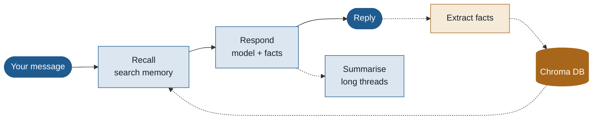
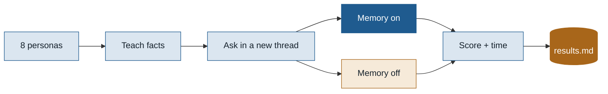

<div align="center">

# Personalised AI Assistant with Contextual Recall

**A chat assistant that remembers you across conversations, and shows you exactly what it remembers.**

[](https://github.com/manjuv03/Personalized-AI-Assistant-with-Contextual-Recall/actions/workflows/tests.yml)


[How it works](docs/HOW_IT_WORKS.md) · [Project report](PROJECT_REPORT.md) · [Usage guide](USAGE.md) · [Results](eval/results.md)

</div>

---

## At a glance

| **100%** | **10%** | **0.94 s** | **74 ms** |
|:---:|:---:|:---:|:---:|
| questions answered from earlier conversations, memory on | the same questions, memory off | average response time | median memory recall |

<sub>Gemini 3.5 Flash Lite · local MiniLM embeddings · 8 personas, 20 questions, each asked in a brand-new conversation. Small test set with keyword scoring; see the [report](PROJECT_REPORT.md#12-outcome).</sub>

---

## What it does

Most chatbots either **forget you** when a conversation ends, or **send the whole history** every time until they become slow and expensive. This assistant sits in between:

- **Remembers what matters.** After each message it picks out durable facts (your name, course, preferences, goals) and stores them in Chroma DB.
- **Brings back only what's relevant.** Each new message is matched by meaning against your stored facts, and the best few go into the prompt.
- **Stays fast as chats grow.** Older messages are folded into a running summary, and saving memories happens after the reply is sent.
- **Handles corrections.** "Actually, my shop is called Ember & Oak now" replaces the old fact instead of keeping both.
- **Shows its memory.** The web UI lists the memories used for every reply, everything it knows about you (with a delete button), a map of those memories and a log of every turn.

---

## How it works



<sub>Solid line: what you wait for. Dashed line: runs in the background.</sub>

There are two kinds of memory working together:

| | Long-term memory | Short-term memory |
|---|---|---|
| **Holds** | Durable facts about you | The current conversation |
| **Lives in** | Chroma DB, filtered by user | LangGraph checkpointer, per thread |
| **Written** | In the background, after each reply | Every turn |
| **Kept small by** | Near-duplicates (cosine ≥ 0.92) update the old fact | At 16 messages, older ones are summarised and trimmed back to 8 |
| **Used as** | Top 5 facts in the system prompt | Summary + recent messages |

<details>
<summary><b>How memories are ranked</b></summary>

<br/>

Chroma finds the closest facts by meaning. They're then re-ranked:

```
score = 0.75 × similarity + 0.15 × importance + 0.10 × recency
recency = 0.5 ^ (age in days / 30)
```

Similarity matters most; importance and recency break ties. So "the user's name is Priya" (important, recent) beats a passing remark about the weather even if the remark is slightly closer in meaning. Facts scoring below 0.25 are dropped.

</details>

<details>
<summary><b>How it stays reliable and fast</b></summary>

<br/>

- **Retries:** busy (503), rate-limited (429), timed-out or dropped requests are retried with exponential backoff; other errors fail straight away. If the model stays busy, the UI says so clearly.
- **Background saving:** fact extraction is a second model call, so it runs after the reply is sent.
- **Batched summaries:** the extra summary call happens about once every 4 turns, not every turn.
- **Speed settings:** low thinking level for Gemini 3, capped reply length, and the embedding model loads at start-up.

</details>

---

## Tech stack

| Layer | Tools | Why |
|---|---|---|
| Agent | **LangGraph**, LangChain | Clear steps with shared state; per-conversation checkpointer |
| Memory | **Chroma DB**, all-MiniLM-L6-v2 | Local, persistent vector search with per-user filters; free embeddings with no rate limits |
| Models | **Gemini** (free tier), OpenAI, Ollama | Switch with one `.env` line; Ollama runs fully offline |
| Backend | **FastAPI**, Uvicorn, SQLite | Typed API, background tasks, zero-setup logs |
| Frontend | HTML, CSS, JavaScript | One file, no build step |
| Quality | pytest, GitHub Actions | Offline tests with fakes run on every push |

Every choice, and the alternatives, are explained in [docs/HOW_IT_WORKS.md](docs/HOW_IT_WORKS.md#3-the-technologies-and-why-each-one-is-used).

---

## Quick start

Needs **Python 3.10–3.13**.

```bash
git clone https://github.com/manjuv03/Personalized-AI-Assistant-with-Contextual-Recall.git
cd Personalized-AI-Assistant-with-Contextual-Recall
python3.12 -m venv .venv && source .venv/bin/activate   # Windows: .venv\Scripts\activate
pip install -r requirements.txt
cp .env.example .env
```

Get a free key from [Google AI Studio](https://aistudio.google.com/apikey) and set these in `.env`:

```
LLM_PROVIDER=gemini
LLM_MODEL=gemini-3.5-flash-lite
LLM_THINKING_LEVEL=minimal
GOOGLE_API_KEY=your-key
```

Then start it and open **http://localhost:8000**:

```bash
uvicorn app.api:app --reload
```

Prefer OpenAI? Set `LLM_PROVIDER=openai` and `OPENAI_API_KEY`. Fully local? Use `LLM_PROVIDER=ollama` with `LLM_MODEL=llama3.1`.

**Try it:** in thread `main`, tell it about yourself. Change the **thread** box to `test2` and ask "What am I studying?". Then open **Recalled** to see the memories it used. Untick **memory** to compare.

More in the [usage guide](USAGE.md): starting and stopping, updating, settings and troubleshooting.

---

## Evaluation



Each question is asked in a **brand-new conversation**, so only long-term memory can help, and again with memory **off** as a baseline. A question passes if the reply contains an expected keyword.

| | With memory | Without memory |
|---|---|---|
| Continuity | **100%** (20 / 20) | 10% (2 / 20) |
| Mean response time | 941 ms | 865 ms |
| p95 response time | 2,278 ms | 1,658 ms |
| Recall step alone | median 74 ms · mean 150 ms | n/a |

Reproduce it:

```bash
python -m eval.run_eval --runs 1 --delay 5   # --delay keeps within free-tier limits
```

---

<details>
<summary><b>API</b></summary>

<br/>

| Method | Path | Purpose |
|---|---|---|
| POST | `/chat` | `{user_id, thread_id, message, use_memory}` → reply, recalled memories, latency |
| GET | `/users/{user_id}/memories` | List stored memories |
| POST | `/users/{user_id}/memories` | Add a memory by hand |
| DELETE | `/users/{user_id}/memories/{id}` | Forget a memory |
| GET | `/users/{user_id}/memory-map` | 2-D coordinates for the memory map |
| GET | `/users/{user_id}/threads/{thread_id}/summary` | Running summary of a thread |
| GET | `/users/{user_id}/logs` | Recent turns and average latency |

Interactive docs at `/docs` while the server runs.

</details>

<details>
<summary><b>Project structure</b></summary>

<br/>

```
app/
  api.py              FastAPI routes, error handling, start-up warm-up
  service.py          Assistant: runs the graph, saves memories, logs turns
  graph.py            LangGraph agent: recall -> respond -> summarise
  memory/
    long_term.py      Chroma DB store, ranking, de-duplication, memory map
    short_term.py     Rolling-summary helpers
    extractor.py      Fact extraction prompt + forgiving JSON parser
  retry.py            Retries for busy or rate-limited models
  llm.py              Model and embedding factories
  logs.py             SQLite interaction log
  config.py           Settings from .env
  static/index.html   Web UI
eval/                 Personas, scoring and the evaluation runner
tests/                Offline tests (no API key needed)
docs/HOW_IT_WORKS.md  Full guide to the concepts and code
```

</details>

<details>
<summary><b>Tests</b></summary>

<br/>

```bash
python -m pytest
```

25 tests using an in-memory vector store, hashing embeddings and a scripted model, so they need no network or key. They cover ranking, de-duplication, user isolation, fact parsing, summarising, retries, logging, and an end-to-end check that a fact told in one conversation is recalled in another. GitHub Actions runs them on every push.

</details>

---

## Documentation

| Read this | If you want to |
|---|---|
| [docs/HOW_IT_WORKS.md](docs/HOW_IT_WORKS.md) | Understand the concepts, technologies and code well enough to build it yourself |
| [PROJECT_REPORT.md](PROJECT_REPORT.md) | See why it was built, the design, results and lessons learned |
| [USAGE.md](USAGE.md) | Run, update and troubleshoot it on macOS |

## Roadmap

- [ ] Memory as tools the agent chooses to use (search, save, forget)
- [ ] Streaming replies over Server-Sent Events
- [ ] Persistent conversation threads (SQLite checkpointer)
- [ ] Larger evaluation with an LLM judge
- [ ] Memory decay and merging of related facts

---

<div align="center">

Built by **Manju Swaroop V** · [LinkedIn](https://www.linkedin.com/in/manju-swaroop-v) · [GitHub](https://github.com/manjuv03) · MIT licence

</div>
