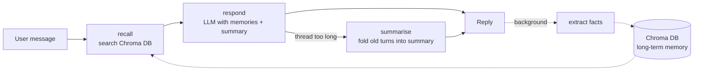

# Personalised AI Assistant with Contextual Recall

[](https://github.com/manjuv03/Personalized-AI-Assistant-with-Contextual-Recall/actions/workflows/tests.yml)

A conversational assistant that remembers the people it talks to. It is built with **LangChain** and **LangGraph**, keeps long-term facts about each user in **Chroma DB**, and keeps the current conversation compact with a running summary. A **FastAPI** backend serves the chat, the memory store, interaction logs and a small web UI that shows exactly which memories were used for every reply.

## Why

Most chatbots forget you the moment a conversation ends, or they stuff the whole history into the prompt until it becomes slow and expensive. I wanted an assistant that:

- remembers durable things about a person (name, preferences, goals, projects) across separate conversations,
- only brings back what is relevant to the current message,
- keeps each conversation short enough to stay fast, and
- makes its memory visible, so you can see and correct what it knows.

## How it works



There are two kinds of memory:

| | Long-term memory | Short-term (contextual) memory |
|---|---|---|
| What | Durable facts about the user | The current conversation |
| Where | Chroma DB, one collection, filtered by `user_id` | LangGraph checkpointer, per thread |
| Written | After each reply, in the background: an LLM pulls facts out of the user's message | Every turn |
| Kept small by | De-duplication: a near-identical fact (cosine ≥ 0.92) updates the old one instead of adding a new one | Once a thread passes `KEEP_RECENT_MESSAGES`, older turns are folded into a running summary and removed |
| Used | Top-k facts are added to the system prompt | Summary + recent messages go to the model |

**Ranking recalled memories.** Chroma returns the closest facts by cosine similarity. I over-fetch and re-rank them with

`score = 0.75 × similarity + 0.15 × importance + 0.10 × recency`

where recency halves every 30 days. Similarity matters most; importance and recency break ties, so "the user's name is Priya" beats a passing remark when both are about equally relevant. Facts below `RECALL_MIN_SCORE` are dropped.

**Corrections.** If the user says "actually, my coffee shop is called Ember & Oak now", the new fact is close enough to the old one to replace it, and the system prompt tells the model to trust what the user says now over older memories.

**Busy models.** Hosted models sometimes reply "503 high demand" or "429 quota". Every model call retries those with exponential backoff (`LLM_MAX_RETRIES`, default 4). If the model is still busy, the API returns a 503 with a clear message and the UI shows "The model is busy right now", rather than a generic server error. Other errors, like a bad key, fail straight away.

**Latency.** Fact extraction is a second LLM call, so it runs as a FastAPI background task after the reply is sent. The user only waits for recall + one model call (plus a summary call every few turns on long threads). On top of that:

- replies are capped at `LLM_MAX_TOKENS` (default 1024),
- Gemini 3 models run with a low thinking level (`LLM_THINKING_LEVEL=low`), which answers much faster,
- the embedding model and Chroma DB load when the server starts, so the first message isn't slow,
- requests that hang give up after `LLM_TIMEOUT` seconds and are retried.

## Project structure

```
app/
  api.py              FastAPI routes
  service.py          Assistant: runs the graph, writes memories, logs turns
  graph.py            LangGraph agent: recall -> respond -> summarise
  memory/
    long_term.py      Chroma DB store, ranking, de-duplication, PCA memory map
    short_term.py     Rolling-summary helpers
    extractor.py      LLM fact extraction + robust JSON parsing
  logs.py             SQLite interaction log
  llm.py              Chat model / embedding factories (OpenAI, Gemini, Ollama, Hugging Face)
  config.py           Settings from environment variables
  static/index.html   Chat UI with recalled-memory, memory list, memory map and log panels
eval/
  scenarios.json      Personas: facts to teach + questions to ask later
  metrics.py          Scoring helpers
  run_eval.py         Continuity and latency evaluation
tests/                Unit tests (run offline, no API key)
```

## Getting started

Needs **Python 3.10 to 3.13** (some dependencies, like numpy and Chroma, don't ship builds for newer versions yet).

```bash
python3.12 -m venv .venv && source .venv/bin/activate   # Windows: .venv\Scripts\activate
pip install -r requirements.txt
cp .env.example .env
uvicorn app.api:app --reload
```

In `.env`, either add an `OPENAI_API_KEY`, or use Gemini with a free key from [Google AI Studio](https://aistudio.google.com/apikey):

```
LLM_PROVIDER=gemini
LLM_MODEL=gemini-3.8-flash
GOOGLE_API_KEY=your-key
```

Open http://localhost:8000. For starting, stopping, updating and fixing common problems later, see [USAGE.md](USAGE.md). For the full write-up of why and how this was built, see [PROJECT_REPORT.md](PROJECT_REPORT.md). Tell it a few things about yourself, change the **thread** box to start a fresh conversation, and ask about them. The side panel shows:

- **Recalled**: the memories used for the last reply, with similarity and final score
- **Memories**: everything stored for this user, with a button to forget any item
- **Map**: a 2-D PCA projection of the memory embeddings, coloured by category
- **Logs**: every turn with latency, how many memories were recalled and how many were stored

Untick **memory** to compare the same question with recall switched off.

Using a different model is a `.env` change, for example `LLM_PROVIDER=gemini` with `LLM_MODEL=gemini-2.0-flash`, or `LLM_PROVIDER=ollama` with `LLM_MODEL=llama3.1` for a fully local setup.

## API

| Method | Path | Purpose |
|---|---|---|
| POST | `/chat` | `{user_id, thread_id, message, use_memory}` → reply, recalled memories, latency |
| GET | `/users/{user_id}/memories` | List stored memories |
| POST | `/users/{user_id}/memories` | Add a memory by hand |
| DELETE | `/users/{user_id}/memories/{id}` | Forget a memory |
| GET | `/users/{user_id}/memory-map` | 2-D coordinates for the memory map |
| GET | `/users/{user_id}/threads/{thread_id}/summary` | Running summary of a thread |
| GET | `/users/{user_id}/logs` | Recent turns and average latency |

Interactive docs are at `/docs`.

## Evaluation

`eval/run_eval.py` measures **response continuity**: whether the assistant can use facts from an earlier conversation.

For each persona in `eval/scenarios.json`, the assistant is told some facts in one thread. Then, in a brand-new thread (so the conversation history can't help), it is asked questions that need those facts, once with memory on and once with it off. A probe passes if the reply contains an expected keyword. The script also records the latency of the recall step on its own and of the full chat turn.

```bash
python -m eval.run_eval --runs 3
python -m eval.run_eval --delay 4   # on a free tier: wait 4 s between model calls
```

Probes that can't run because the model stays busy are skipped and counted, not scored as failures.

Results are written to `eval/results.md` (continuity with vs without memory, mean and p95 latency, and any failed probes) and `eval/results.json` (every reply). Latency depends heavily on the chat model and network, so the recall step is reported separately from the model call.

## Tests

```bash
pytest
```

The tests use an in-memory vector store, hashing embeddings and a scripted model, so they run without a network or an API key. They cover ranking, de-duplication, user isolation, fact parsing, summarisation, logging, and an end-to-end check that a fact from one thread is recalled in another.

## Next steps

- Let the agent call memory tools itself (search / save / forget) instead of always recalling
- Streaming replies over Server-Sent Events
- Persistent checkpointer (SQLite or Postgres) so threads survive restarts
- Memory decay and periodic consolidation of related facts

## Author

Manju Swaroop V · [LinkedIn](https://www.linkedin.com/in/manju-swaroop-v) · [GitHub](https://github.com/manjuv03)
